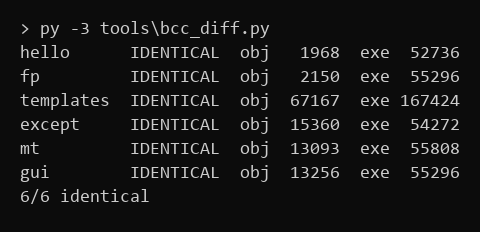

# Borland C++ 5.5 — Static Recompilation

Static recompilation of the **Borland C++ 5.5.1 Free Command-Line Tools**
(Borland, 2000): the compiler `bcc32.exe` and the linker `ilink32.exe`, from
their shipping Win32 executables to native C. It is pcrecomp's first
compiler, and its first program built by a compiler other than MSVC: both
tools carry Borland's own run-time library (its startup code, threadvars,
exception handling, and hand-written assembly in the preprocessor). Each is
lifted to C, compiled with MSVC and run on pcrecomp's `native32` host, which
calls the real kernel32 and user32. It runs Borland's code; it is not a
rewrite. A compiler is the easiest program there is to check: the original
and the recompiled one, given the same input, must write the same bytes.

Built on the [pcrecomp](https://github.com/sp00nznet/pcrecomp) toolchain
(`main`), and following its
shared house style.



## Getting Started

You need **your own copy of the Borland C++ 5.5 Free Command-Line Tools**:
the `BCC55` folder holding `Bin\bcc32.exe`, which Borland's free installer
(`freecommandLinetools.exe`) puts in `C:\Borland\BCC55`. Nothing of Borland
C++ is in this repository or downloaded for you; everything is built on your
machine from your copy.

### The setup script

1. Download this repository (the green **Code** button, then **Download ZIP**)
   and unzip it somewhere with 1 GB free.
2. Windows: double-click **`Setup.cmd`**. (Linux and macOS: not yet, see
   below.)
3. Open **`BCC55 Recomp Prompt`** in that folder: a command prompt with
   `bcc32recomp` and `ilink32recomp` on `PATH`.

The script asks before installing anything (Python 3.10+, `pefile` and
`capstone`, git, the Visual Studio 2022 Build Tools), clones pcrecomp
`main` beside the repository, finds Borland C++ in
`C:\Borland\BCC55` or asks where it is, then catalogs, lifts and builds both
tools and runs the conformance harness. It takes about 15 minutes with the
tools already installed; a rerun skips finished steps, and the details go to
`setup.log`. `Setup.cmd -GameDir <BCC55 folder> -Yes` asks nothing.

The same steps by hand, with their expected output, are in
**[docs/building.md](docs/building.md)**.

`setup.sh` says so and exits: there is no Linux or macOS build yet.

### Using it

The hosts take the tools' own command lines, unchanged:

```
bcc32recomp -c -I%BCC55%\Include hello.c
ilink32recomp -L%BCC55%\Lib -Tpe -ap -x -c -Gn c0x32.obj hello.obj, hello.exe, , import32.lib cw32.lib
```

The host's own settings (`BCC55_BIN`, `BCC55_WATCHDOG`, `BCC55_TRACE`) are in
[docs/building.md](docs/building.md#using-the-hosts).

## Status

**v0.1.0, alpha.** Both tools lift with 0 errors, and on every program in the
corpus the recompiled tools write the same bytes as the originals. That is
what `tools/bcc_diff.py` proves: **6 of 6 byte-identical**.

| | bcc32 | ilink32 |
|---|---|---|
| Functions found (`disasm32`) | 6,390 | 2,633 |
| Lifted to C | 6,401, 0 errors | 2,635, 0 errors |
| Imports bound to real Windows | 70, 0 unresolved | 81, 0 unresolved |
| Harness: output identical to the original | `.obj` 6 of 6 | `.exe` 6 of 6 (clock stamps masked) |

The six programs in `tests/` cover C, x87 floating point, templates and the
bundled STL, C++ and structured exceptions, the multithreaded RTL, and a
Win32 GUI program; each one built by the recompiled tools also runs and
prints what its `tests/*.expect` says. Not covered yet: `bcc32` without `-c`
starts the *original* `ilink32.exe`, and `RLINK32.DLL` and `LNKDFM50.DLL`,
which ilink32 loads, run as native code. Tested against pcrecomp
`main`.

[bringup.md](docs/bringup.md) is the log of each wall and its fix, and
[ROADMAP.md](ROADMAP.md) what comes next.

## Screenshots

The harness, run by `Setup.cmd` from a fresh clone (above). It is a
command-line tool, so that is the picture.

## Documentation

- [docs/building.md](docs/building.md): the setup steps by hand, building, using the hosts
- [docs/testing.md](docs/testing.md): the conformance harness, the corpus, what is masked
- [docs/bringup.md](docs/bringup.md): every wall so far and its fix
- [ROADMAP.md](ROADMAP.md), [CHANGELOG.md](CHANGELOG.md), [CONTRIBUTING.md](CONTRIBUTING.md)

## Contributors

See **[CONTRIBUTORS.md](CONTRIBUTORS.md)** for who did what.

## License

MIT for this repository's own code ([LICENSE](LICENSE)). Borland C++ 5.5 is
© 1993-2000 Borland (now Embarcadero); none of its files, and nothing
generated from them, is in this repository ([NOTICE.md](NOTICE.md)).
